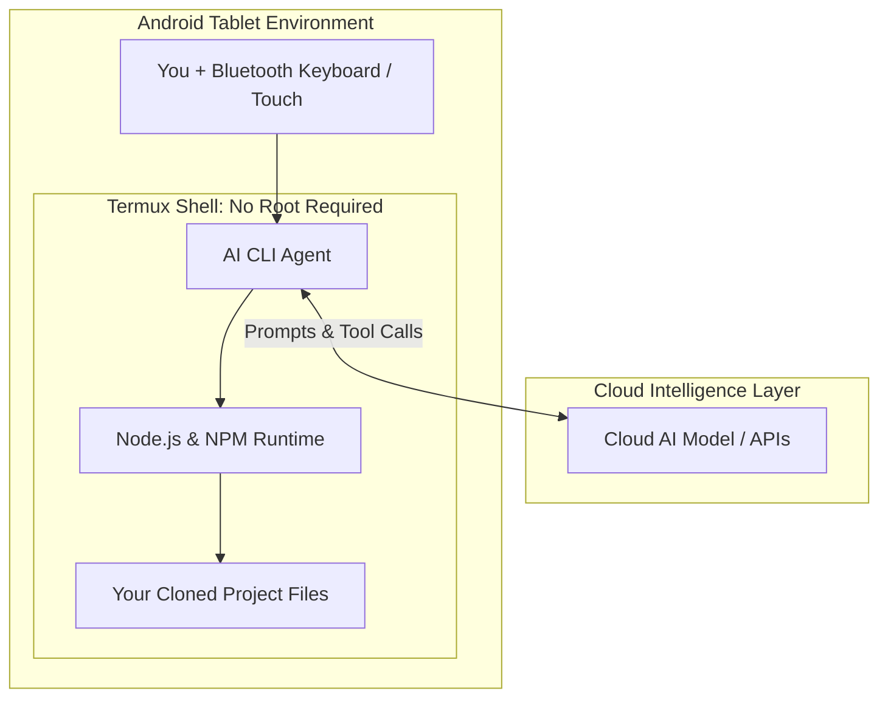

## Having a personal computer is great—and considered a necessity nowadays.

Not everyone has their own machine.

Owning one is already a big deal, and getting one is tough, especially when hardware prices keep climbing.

The ideal PC setup (especially if you work in IT or you're a tech nerd) is familiar: your own desk, a dedicated machine with plenty of RAM, dual monitors, and hours of uninterrupted time to break and build things.

In real life, especially in the Philippines? That laptop is often shared family territory.

In my case, whenever family members need to borrow the laptop for schoolwork, an urgent errand, or something they need to get done, I gladly hand it over. It makes total sense—they need it for essential tasks, while I’m usually just doing casual side project tinkering and self-learning. My unspoken rule was simple: wait until they're done, and then I get my turn.

_Except recently, I ran into a self-inflicted dilemma brought on by my own impulsiveness._

I subscribed to the Google AI Pro plan.

So far, my experience with it has been a blast. It makes building, experimenting, and iterating on side projects genuinely fun and fast. But that created a brand-new friction: **how do I make sure this subscription doesn’t go to waste?**

I paid for it, so naturally, I want to use it as much as I can. Waiting around for the laptop to be free meant watching active subscription days tick away while doing nothing. 

Given my limited hardware access, I caught myself looking at my Android tablet and thinking: *why not just do agentic development on this?*

> You don’t need a beefy desktop rig just to run modern AI workflows. The heavy reasoning happens on cloud servers—your device only needs to manage project files, run a runtime, and talk to an API.

## The mobile harness trap versus the raw terminal.

Naturally, the first question was whether this was even possible.

I started digging around and immediately ran into mobile harness apps. Most of them are slick chat-based UIs designed to mimic development environments on Android. While they look clean, they just didn’t fit my workflow. 

Agentic development isn't just chatting back and forth with an LLM in a text box. It is a genuine feedback loop:
- The agent inspects your repository and checks dependencies.
- It modifies your actual source files across directories.
- It runs local build scripts, linters, or tests in a real shell.
- It reads whatever errors pop up in `stderr` and iteratively fixes them.

A chat bubble can't run your build scripts or manage git branches cleanly. You don't just need an AI interface; you need an actual POSIX-like command line.

That search led me past mobile UI wrappers and straight into **Termux**—an open-source app that brings a powerful, Linux-like CLI environment directly to Android.

## Wait, do I need to root my Android device?

Short answer: definitely not.

It is easy to assume that running Linux tools on mobile requires voiding your warranty, unlocking bootloaders, or risking a bricked device. 

Rooting gives you absolute access to Android’s root partition (`/system`, `/data`), but your coding projects don't need to mess with phone kernels or hardware internals. Cloud-based agents only need:
1. A safe space to store and edit project files.
2. Standard tools like Git and Node.js.
3. An outbound internet connection to reach cloud APIs.

Termux provides all of that entirely inside an unprivileged user sandbox. Your device remains secure, your banking apps keep working, and you still get a proper development shell.



Because the cloud models do the heavy cognitive lifting, the tablet stays cool, battery drain remains manageable, and the terminal stays responsive.

## Setting it up step-by-step.

Setting up Termux for a Node.js project is surprisingly clean once you know which version to grab and how to avoid the common mobile pitfalls.

### 1. Grab Termux from F-Droid (Not the Play Store)

This is the most critical first step. The Google Play Store build of Termux has been deprecated for a long time due to legacy Android OS policies. If you install it from Google Play, your package mirrors will fail immediately.

Download the latest APK directly from [F-Droid](https://f-droid.org/en/packages/com.termux/) or from the [Termux GitHub Releases](https://github.com/termux/termux-app/releases).

Once installed, open the app, update your packages, and grant storage permissions:

```bash
# Update repository mirrors and base packages
pkg update && pkg upgrade -y

# Grant storage access to your device's shared folders
termux-setup-storage

```

Running `termux-setup-storage` creates a `~/storage` symlink folder inside Termux, which lets you easily share files with Android's internal storage if you ever need to inspect assets or preview files externally.

### 2. Install Node.js, npm, and Build Tools

Since the side project I ported over is built on Node.js, getting `node` and `npm` running was priority number one.

In native Termux, you can install everything in one go:

```bash
pkg install nodejs-lts git build-essential -y

```

`build-essential` is vital here. Many npm packages compile native C/C++ bindings during installation, and having standard compiler tools available prevents unexpected install crashes.

Verify that both runtimes are healthy:

```bash
node -v
npm -v

```

### 3. Clone your project

For the best file read/write performance with AI agents and npm builds, clone your project directly inside Termux’s native home directory:

```bash
# Clone directly into Termux private storage
git clone [https://github.com/your-username/your-node-project.git](https://github.com/your-username/your-node-project.git)
cd your-node-project

# Install dependencies and test your build
npm install
npm test

```

*(Note: If you plan to run specialized agent binaries that are strictly compiled for Linux x64—such as experimental Google CLI binaries like `agy`—you can install an Ubuntu PRoot container with `pkg install proot-distro`, set up an Ubuntu environment, and use `box64` as an x64-to-ARM64 translation layer. For standard Node.js projects, native Termux is faster and simpler.)*

## The troubleshooting log: Snags I hit and how to fix them.

Things rarely work on the very first try when tinkering with mobile environments. Here are the exact errors I encountered and how to resolve them:

### "Cannot run pkg install as root user"

If you experiment with an Ubuntu container via `proot-distro` to run specific x64 tools and type `pkg install`, Termux blocks the command.

* **Why it happens:** Your shell prompt starts with `root@...` because you are inside the Ubuntu container. The `pkg` command is specific to native Termux, whereas Ubuntu uses `apt`.
* **The fix:** Use Ubuntu's native package manager instead:
```bash
apt update && apt install <package-name> -y

```


*(If you ran `su` inside native Termux by mistake, simply type `exit` to get back to your standard `$` user prompt.)*

### "npm: command not found" (Even though Node is installed)

This can be confusing: you run `node -v` and see a version number, but typing `npm -v` throws `command not found`.

* **Why it happens:**
1. Inside an Ubuntu container, Ubuntu’s default repository splits `nodejs` and `npm` into separate packages.
2. Inside native Termux, the shell might not have indexed the path to the newly installed binary yet.


* **The fix:**
* If you are inside Ubuntu, install npm explicitly:
```bash
apt update && apt install npm -y

```


* If you are in native Termux, force the shell to refresh its binary hash cache:
```bash
hash -r
npm -v

```


## A different kind of focus.

Is coding on a tablet screen 100% as plush as sitting in front of a wide-screen laptop with a mechanical keyboard?

Of course not. Using an on-screen touch keyboard for terminal commands gets tedious, so pairing a compact Bluetooth keyboard makes a huge difference.

*But there is something surprisingly refreshing about the workflow.*

On a laptop, it’s so easy to drown in distractions—dozens of open browser tabs, music apps, background notifications, and five different editor panes. On an Android tablet running Termux in full screen, it's just you, a dark terminal, and your codebase.

It's quiet, straightforward, and lets you focus.

You review your code, run your agentic workflow, inspect the diffs, and push your commits. Best of all: my family gets the laptop whenever they need it, my Google AI subscription stays active and useful, and I still get to keep building whatever project is on my mind.

A hardware bottleneck shouldn't be your reason to stop building great things that make impact.

## References

* [Termux Official Documentation & Guides](https://termux.dev/en/)
* [Termux on F-Droid](https://f-droid.org/en/packages/com.termux/)
* [Termux App Repository on GitHub](https://github.com/termux/termux-app)
* [PRoot Distro Documentation](https://github.com/termux/proot-distro)
* [NodeSource Node.js Binary Distributions](https://github.com/nodesource/distributions)
